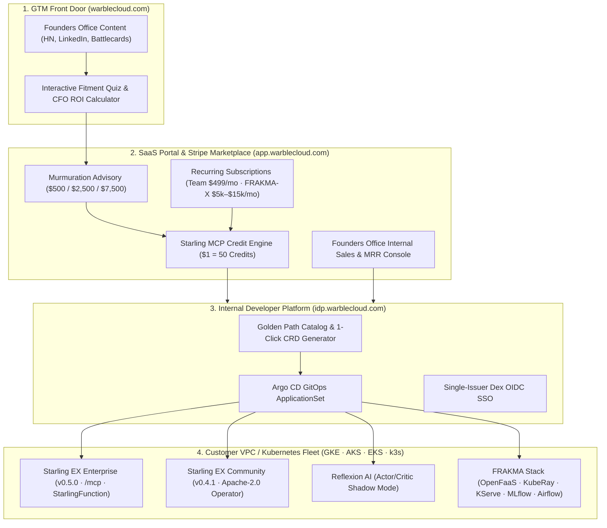

# Warble Cloud (`warblecloud.com`) — Founders Office Master Blueprint & Execution Report

**Entity:** `warblecloud, LLC` (Delaware) · Engineering: `Chirpstack LLP` (India)  
**GitHub Organization:** [`https://github.com/warbletech`](https://github.com/warbletech)  
**Core Brand Narrative:** *"Avirka thinks. Phronix decides. Warble speaks. Frakma builds."*  
**Tagline:** *Your OWN Cloud and AI Tooling. Zero lock-in. Total autonomy.*

---

## 1. Option A Micro-Repositories Created & Synced under `warbletech`

We cloned and synthesized the core documentation, architecture ADRs, design system, and marketplace assets from [`warbletech/warble-docs`](https://github.com/warbletech/warble-docs), [`warbletech/warble-marketing`](https://github.com/warbletech/warble-marketing), [`warbletech/starling-ex`](https://github.com/warbletech/starling-ex), and [`warbletech/starling-ex-community`](https://github.com/warbletech/starling-ex-community), and provisioned three new modular micro-repositories under `warbletech`:

| Repository | Target Domain | What Was Built & Synced |
| :--- | :--- | :--- |
| **[`warbletech/warble-idp-portal`](https://github.com/warbletech/warble-idp-portal)** | `idp.warblecloud.com` | **Internal Developer Platform & Fleet Deployer**: Golden-path service catalog, 1-click deployment engine for `starling-ex` (v0.5.0), `starling-ex-community` (v0.4.1), `reflexion-ai`, and `frakma-oss`. Includes synced architecture docs & ADRs from `warble-docs`, Argo CD `ApplicationSet` (`app-of-apps.yaml`), and unified `deploy-fleet.sh` / `deploy-fleet.ps1` scripts. |
| **[`warbletech/warble-saas-marketplace`](https://github.com/warbletech/warble-saas-marketplace)** | `app.warblecloud.com` / `warblecloud.com` | **Internal SaaS Portal, Stripe Marketplace & Subscription Engine**: Upgrades the static marketplace from `warble-marketing/campaign/marketplace` into a full recurring Stripe Subscription (`mode=subscription`) + Fixed-Price Advisory (`mode=payment`) + Starling MCP Credit Metering (`$1 = 50 credits`) + Founders Office Sales/MRR Admin Console. |
| **[`warbletech/warble-founders-gtm`](https://github.com/warbletech/warble-founders-gtm)** | `warblecloud.com` | **Founders Office Promotional & GTM Launch Hub**: Syncs strategy, pitches, and ICP rubrics from `warble-marketing` and `warble-docs`, plus net-new `Show HN` launch post, 5-part Founder LinkedIn series, 4 live-call Sales Battlecards (Datadog, incident.io/PD, Hyperscalers, AI Wrappers), and an interactive **Fitment Quiz & CFO GPU/MTTR ROI Calculator**. |

---

## 2. End-to-End Platform & Commercial Architecture

---

## 3. Subscription Tiers, Murmuration Wedge & Starling Credits

| Category | SKU Key | Offer Name | Pricing | Bundled Starling MCP Credits |
| :--- | :--- | :--- | :--- | :--- |
| **Subscription** | `warble-cloud-team` | Warble Cloud Team | **$499 / month** | `25,000 credits / mo` |
| **Subscription** | `frakma-x-starter` | FRAKMA-X Managed Starter | **$5,000 / month** | `100,000 credits / mo` |
| **Subscription** | `frakma-x-growth` | FRAKMA-X Managed Growth ★ | **$15,000 / month** | `350,000 credits / mo` |
| **Advisory Wedge** | `murmuration-niche` | Murmuration Niche Advisory | **$500 one-time** | `5,000 credits` ($100 value) |
| **Advisory Wedge** | `murmuration-growth` | Murmuration Growth Engagement ★ | **$2,500 one-time** | `25,000 credits` ($500 value) |
| **Advisory Wedge** | `murmuration-scale` | Murmuration Scale Partner | **$7,500 one-time** | `75,000 credits` ($1,500 value) |
| **Credit Top-Up** | `credits-topup-5k` | Starling MCP 5K Top-Up | **$100 one-time** | `5,000 credits` (`$1 = 50`) |
| **Lifetime Seats** | `starling-pro-10/25/50` | Starling EX Pro (10 / 25 / 50 seats) | **$499 / $999 / $1,799** | `10,000` / `25,000` / `50,000` |

---

## 4. Five-Domain Ecosystem Architecture, Stripe Financing & Self-Healing Regime

**"Next Big Thing" Positioning:**  
> *"Warble is the Voice for Future AI — Defining the True Nature of AI, ML, and Data. Leverage Warble for Your AI Experiments & Continuous Learning. With the Warble Tech Stack, You Own and Offset Your MLOps and DataOps Workload."*

| Domain | Role in Ecosystem | Key Capabilities |
| :--- | :--- | :--- |
| **`warbleoss.org`** | Open-Source Capability Showcase | Apache-2.0 `starling-ex-community`, `Avirka` SRE/MLOps LLM, `FRAKMA` GitOps reference stack, upstream PR benchmarks |
| **`warblecloud.xyz`** | Ecosystem & Marketplace Index | Fast discovery index routing across operators, MCP credit packs, and advisory modules |
| **`warblecloud.com` / `app.warblecloud.com`** | Commercial Hub, Stripe Financing & Self-Healing Regime | Fixed-price Murmuration advisory, **3-Month Stripe Financing & Ramp Plans**, and interactive **WarbleCloud Self-Healing Regime** simulator |
| **`warblecloud.ai`** | AI-Native Core (`reflexion-ai` + `warble-brain`) | Actor/Critic Shadow-Mode verification and sovereign model memory |
| **`warblelabs.io`** | High-Velocity Research & Continuous Learning Lab | Milvus.io-inspired fast interactive architecture benchmarks for KubeRay + MLflow + Airflow + `pgvector`/Milvus |

### Stripe Financing & Ramp SKUs (`CATALOG.financingPlans`)
- `murmuration-growth-3mo`: **$875/mo × 3 months** (`25,000` Starling MCP credits)
- `murmuration-scale-3mo`: **$2,600/mo × 3 months** (`75,000` Starling MCP credits)
- `frakma-x-starter-ramp`: **$2,500/mo` Q1 Ramp** (`100,000` credits/mo)
- `frakma-x-growth-ramp`: **$7,500/mo` Q1 Ramp** (`350,000` credits/mo)

---

## 5. GitHub Execution Issues & Assignment Matrix (Sections 1–4)

### Part A — Sections 1, 2, and 3 (`@yaksha-warble` → Distribute to `@akshat-warble`)

| Section | Repository | Issue | Assignees | Title |
| :--- | :--- | :--- | :--- | :--- |
| **1A** | `warbletech/warble-idp-portal` | [#1](https://github.com/warbletech/warble-idp-portal/issues/1) | `@yaksha-warble`, `@akshat-warble` | `[Section 1 - IDP Portal] Golden-Path Catalog, Fleet Deployer & Argo CD GitOps Verification` |
| **1B** | `warbletech/warble-saas-marketplace` | [#10](https://github.com/warbletech/warble-saas-marketplace/issues/10) | `@yaksha-warble`, `@akshat-warble` | `[Section 1 - SaaS Marketplace] Stripe Subscriptions, Murmuration Wedge, MCP Credit Metering & Procurement Engine` |
| **1C** | `warbletech/warble-founders-gtm` | [#1](https://github.com/warbletech/warble-founders-gtm/issues/1) | `@yaksha-warble`, `@akshat-warble` | `[Section 1 - Founders GTM] Fitment Quiz & CFO ROI Calculator, Competitive Battlecards & Pitch Deck Exports` |
| **2A** | `warbletech/starling-ex` | [#64](https://github.com/warbletech/starling-ex/issues/64) | `@yaksha-warble`, `@akshat-warble` | `[Section 2 - Starling EX Enterprise v0.5.0] Operator CRDs, Scoped /mcp Server, OTel Audit & Dex OIDC Distribution` |
| **2B** | `warbletech/starling-ex-community` | [#3](https://github.com/warbletech/starling-ex-community/issues/3) | `@yaksha-warble`, `@akshat-warble` | `[Section 2 - Starling EX Community v0.4.1] Apache-2.0 Operator, 1-Click Installer, Next.js Admin UI & License API` |
| **3A** | `warbletech/warble-docs` | [#20](https://github.com/warbletech/warble-docs/issues/20) | `@yaksha-warble`, `@akshat-warble` | `[Section 3 - Warble Docs] VitePress Staff Portal (docs.warblecloud.ai), ADRs 0001-0006 & Cluster Bootstrap Runbooks` |
| **3B** | `warbletech/warble-marketing` | [#67](https://github.com/warbletech/warble-marketing/issues/67) | `@yaksha-warble`, `@akshat-warble` | `[Section 3 - Warble Marketing] 4-Agent Lead-Gen Pipeline (Discover -> Enrich -> Qualify -> Draft) & Five-Domain Ecosystem` |
| **3C** | `warbletech/warble-bootstrap` | [#1](https://github.com/warbletech/warble-bootstrap/issues/1) | `@yaksha-warble`, `@akshat-warble` | `[Section 3 - Warble Bootstrap] Multi-Platform Cloning Automation & Infrastructure Target Matrices` |

### Part B — Section 4: Immediate Next Steps & Ecosystem Cutover (Assigned to `@warble-tech`)

| Step / Ref | Repository | Issue | Assignee | Title |
| :--- | :--- | :--- | :--- | :--- |
| **4.1** | `warbletech/warble-idp-portal` | [#2](https://github.com/warbletech/warble-idp-portal/issues/2) | `@warble-tech` | `[Section 4.1 - Production Deployment] Bind DNS records and Ingress for app.warblecloud.com and idp.warblecloud.com` |
| **4.2** | `warbletech/warble-saas-marketplace` | [#11](https://github.com/warbletech/warble-saas-marketplace/issues/11) | `@warble-tech` | `[Section 4.2 - Credential Injection] Populate live Stripe API keys (STRIPE_SECRET_KEY, STRIPE_WEBHOOK_SECRET) and Cloudflare Turnstile credentials in runtime secrets` |
| **4.3** | `warbletech/warble-founders-gtm` | [#2](https://github.com/warbletech/warble-founders-gtm/issues/2) | `@warble-tech` | `[Section 4.3 - GTM Execution] Trigger Hacker News 'Show HN' launch post & schedule 5-part LinkedIn Founder series` |
| **4.4** | `warbletech/warble-founders-gtm` | [#3](https://github.com/warbletech/warble-founders-gtm/issues/3) | `@warble-tech` | `[Section 4.4 - Ecosystem & Commercial Model] Five-Domain Cutover, LF/AAIF Governance & Commercial Wedge Execution` |
| **4.2a** | `warbletech/warble-saas-marketplace` | [#2](https://github.com/warbletech/warble-saas-marketplace/issues/2) | `@warble-tech` | `Apply Warble Dex Google SSO on dex.warblecloud.com` |
| **4.2b** | `warbletech/warble-saas-marketplace` | [#3](https://github.com/warbletech/warble-saas-marketplace/issues/3) | `@warble-tech` | `Apply live Cloudflare BFM, AI controls, and Turnstile secret` |
| **4.2c** | `warbletech/warble-saas-marketplace` | [#4](https://github.com/warbletech/warble-saas-marketplace/issues/4) | `@warble-tech` | `Add Skydo ACH payout bank on live Stripe` |
| **4.2d** | `warbletech/warble-saas-marketplace` | [#5](https://github.com/warbletech/warble-saas-marketplace/issues/5) | `@warble-tech` | `Wire STRIPE_WEBHOOK_SECRET for live Checkout webhooks` |
| **4.2e** | `warbletech/warble-docs` | [#18](https://github.com/warbletech/warble-docs/issues/18) | `@warble-tech` | `Rotate leaked Cloudflare API token from Reflexion DEPLOY.md history` |
| **4.2f** | `warbletech/warble-docs` | [#19](https://github.com/warbletech/warble-docs/issues/19) | `@warble-tech` | `Point docs SSO access.md at dex.warblecloud.com after Dex cutover` |
